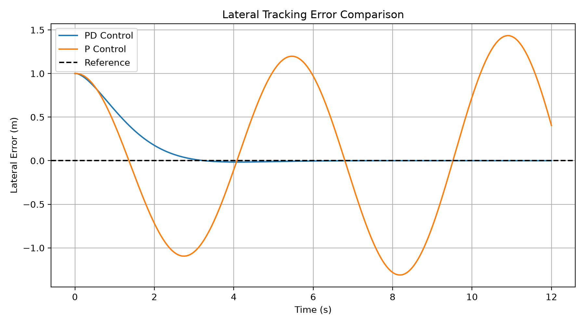
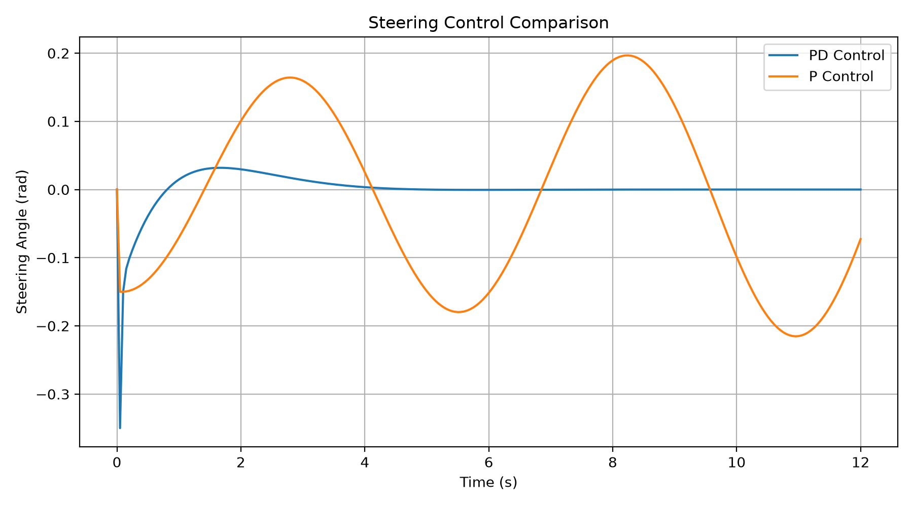

# Vehicle Lateral Tracking Control in C++

基于 C++ 的车辆横向轨迹跟踪控制与性能评测项目，实现运动学自行车模型、P/PD 闭环控制及 Python 仿真数据分析。

## 1. 项目简介

本项目以车辆直线路径跟踪为任务，采用运动学自行车模型描述车辆运动，通过控制前轮转向角减小车辆相对于目标路径的横向误差。

对比 P 和 PD 控制器在相同初始条件下的跟踪表现，并使用 Python 计算性能指标、绘制误差及转向指令曲线。

## 2. 技术栈

- C++、Visual Studio
- 运动学自行车模型、P/PD 控制
- Python、NumPy、Matplotlib
- CSV 数据记录与性能评价

## 3. 车辆模型

车辆状态为横向及纵向位置、航向角和速度：

\[
x_{k+1}=x_k+v_k\cos(\psi_k)\Delta t
\]

\[
y_{k+1}=y_k+v_k\sin(\psi_k)\Delta t
\]

\[
\psi_{k+1}=\psi_k+\frac{v_k}{L}\tan(\delta_k)\Delta t
\]

\[
v_{k+1}=v_k+a_k\Delta t
\]

其中，\(\delta\) 为前轮转向角，\(L\) 为轴距，采用前向欧拉法进行离散更新。

## 4. 实验设置

- 参考路径：\(y=0\) 的直线
- 初始横向偏差：1 m
- 车辆速度：5 m/s
- 轴距：2.8 m
- 仿真步长：0.05 s
- 仿真时长：12 s
- 转向角限制：±0.35 rad

## 5. 实验结果

| 指标 | P 控制 | PD 控制 |
|---|---:|---:|
| 横向误差 RMSE | 0.8835 m | 0.2697 m |
| 最大绝对横向误差 | 1.4352 m | 1.0000 m |
| 最终绝对横向误差 | 0.4043 m | 0.000003 m |
| 调节时间（±0.05 m） | 12 s 内未满足 | 2.7 s |

在当前理想仿真条件下，PD 控制的横向误差 RMSE 相比 P 控制降低约 **69.5%**，并表现出更好的误差收敛特性。

### 横向跟踪误差

### 转向控制指令

## 6. 文件说明

主要文件位于 `github_upload/` 目录：

- `closed_loop_lab.cpp`：运动学自行车模型与闭环控制仿真
- `PID_controller.h/.cpp`：PID 控制器模块
- `analyze_tracking.py`：数据分析与可视化
- `p_tracking.csv`：P 控制实验数据
- `pd_tracking.csv`：PD 控制实验数据
- `*.png`：实验结果对比图

## 7. 当前局限与后续改进

本项目属于教学与算法验证性质的简化仿真，未包含真实车辆测试、轮胎动力学、执行器动态、测量噪声及外部扰动。

后续可增加转向角变化率约束、标准离散 PID 实现、曲线路径跟踪，以及 LQR/MPC 控制器对比。
